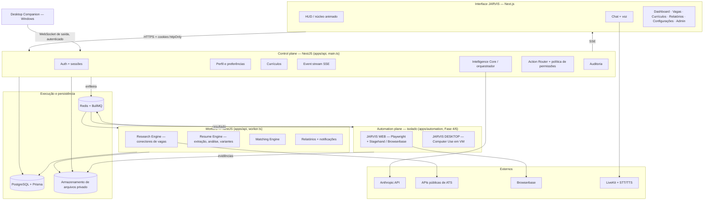
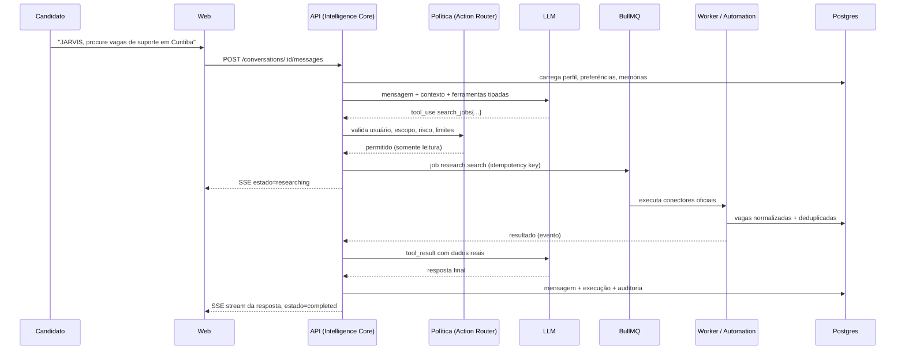
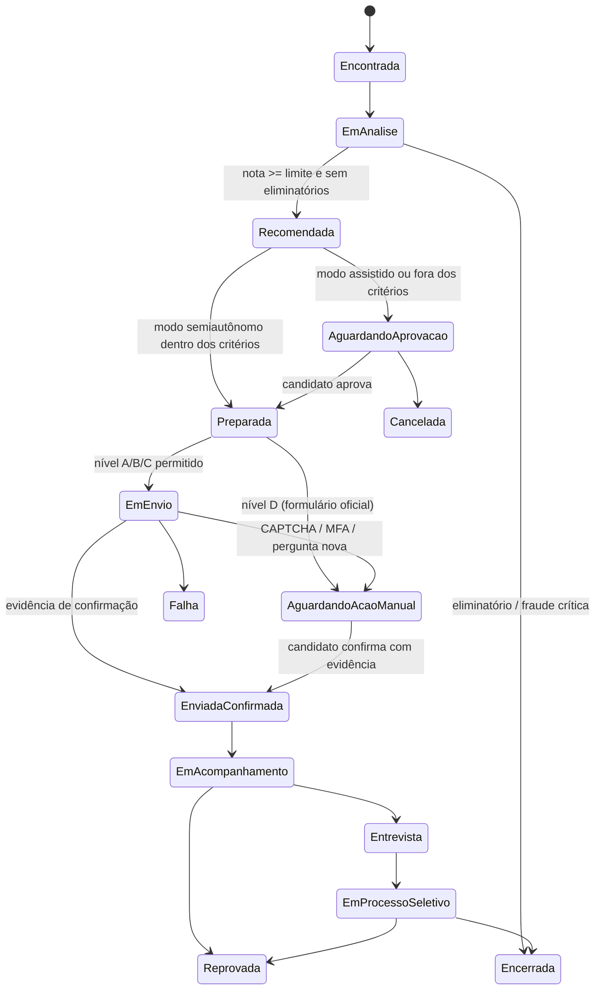

# 01 — Arquitetura do JARVIS Career

## Princípios

1. **O backend é o centro de controle.** Permissões, limites, auditoria e estado vivem no NestJS — nunca no modelo de linguagem, nunca no frontend.
2. **A API não executa automação.** Cliques, downloads, uploads e navegação acontecem num **serviço de automação isolado por sessão** (container/VM), alimentado por filas. A API que atende os clientes nunca abre um navegador no próprio processo.
3. **Nada é simulado.** Uma ação só é registrada como concluída com evidência (resposta de API, mudança de página, mensagem de confirmação, screenshot).
4. **Conteúdo externo é dado, não instrução.** Páginas, currículos e e-mails nunca alteram permissões ou objetivos do agente.
5. **Determinístico primeiro.** Filtros, deduplicação, regras eliminatórias e estatísticas são código; o LLM é usado para interpretar, planejar e redigir.

## Camadas (arquitetura de referência)



### Por que essa divisão

| Processo | Responsabilidade | Escala |
|---|---|---|
| `api` (HTTP) | Autenticação, CRUD, chat, decisões de permissão, SSE | Horizontal, sem estado |
| `worker` | Trabalho de fundo determinístico ou com LLM, sem navegador | Horizontal por fila |
| `automation` | Navegador/desktop, sem acesso ao banco: recebe a tarefa pela fila `automation`, devolve resultado + evidências pela fila `automation-results` (ADR-0010). Hoje: processo separado, um contexto de navegador novo por sessão. Produção: container efêmero por sessão e tarefas assinadas | Por sessão, com limites de tempo, passos e política de rede |

`api` e `worker` compartilham o mesmo código NestJS (dois *entrypoints*), o que mantém módulos, tipos e Prisma em um só lugar. `automation` é um serviço separado porque executa conteúdo não confiável.

## Fluxo de uma solicitação ao agente



## Fluxo de candidatura



"Enviada e confirmada" nunca significa "currículo visualizado pela empresa" — são estados diferentes e o segundo só existe com evidência vinda da própria empresa/ATS.

## Estrutura de diretórios

```
JarvisCareer/
├── apps/
│   ├── api/                 NestJS — control plane (main.ts) + workers (worker.ts)
│   │   ├── prisma/          schema.prisma, migrations/
│   │   ├── src/
│   │   │   ├── common/      config, prisma, guards, filtros, auditoria
│   │   │   ├── modules/
│   │   │   │   ├── auth/            registro, login, refresh, logout
│   │   │   │   ├── users/
│   │   │   │   ├── profile/         perfil profissional e preferências
│   │   │   │   ├── resumes/         upload, armazenamento, extração
│   │   │   │   ├── activity/        eventos do agente + SSE
│   │   │   │   ├── consents/        LGPD
│   │   │   │   └── health/
│   │   │   ├── queues/      definições de filas e processadores
│   │   │   ├── main.ts      HTTP
│   │   │   └── worker.ts    processadores BullMQ (sem HTTP)
│   │   └── test/            e2e
│   ├── web/                 Next.js — interface cinematográfica
│   └── automation/          executor isolado do JARVIS WEB (Playwright) + site de testes
├── packages/
│   └── shared/              contratos Zod + tipos compartilhados API↔Web
├── infra/
│   └── docker-compose.yml   Postgres 5433, Redis 6380
├── docs/                    arquitetura, estratégias, ADRs, pesquisa
├── .mcp.json                MCPs do ambiente de desenvolvimento
└── CLAUDE.md
```

## Modelo de dados (visão)

O schema completo está em [`apps/api/prisma/schema.prisma`](../apps/api/prisma/schema.prisma). Agrupamento:

| Domínio | Entidades | Fase |
|---|---|---|
| Identidade | `User`, `RefreshToken`, `Consent`, `AuditLog` | 1 |
| Perfil | `CandidateProfile`, `CandidatePreferences`, `Experience`, `Education`, `Certification`, `Skill`, `CandidateSkill`, `Language` | 1 |
| Currículos | `Resume`, `ResumeVersion`, `ResumeAnalysis` | 1–2 |
| Agente | `Conversation`, `Message`, `AgentMemory`, `AgentTask`, `AgentEvent`, `UsageRecord` | 1–2 |
| Vagas | `JobSource`, `UserJobSource`, `JobListing`, `JobMatch` | 3 (implementado) |
| Candidaturas | `Application`, `ApplicationEvent`, `ApplicationAnswer` | 5 |
| Automação | `ActionPermission`, `ActionExecution`, `ActionEvidence`, `BrowserSession`, `DesktopSession`, `DeviceAuthorization` | 4–6 |
| Comunicação | `Notification`, `Report` | 8 |

Toda tabela de dados do candidato carrega `userId` e todo acesso passa por serviços que filtram por `userId` do token — o isolamento multiusuário é aplicado no backend (ver [03-seguranca-lgpd.md](03-seguranca-lgpd.md)).

**pgvector**: não é adotado na Fase 1. A memória semântica da Fase 2 começa com memórias estruturadas (fatos, preferências, decisões) recuperadas por tipo e recência; pgvector entra apenas se a avaliação mostrar que a recuperação por estrutura não basta (ADR a escrever na Fase 2).
